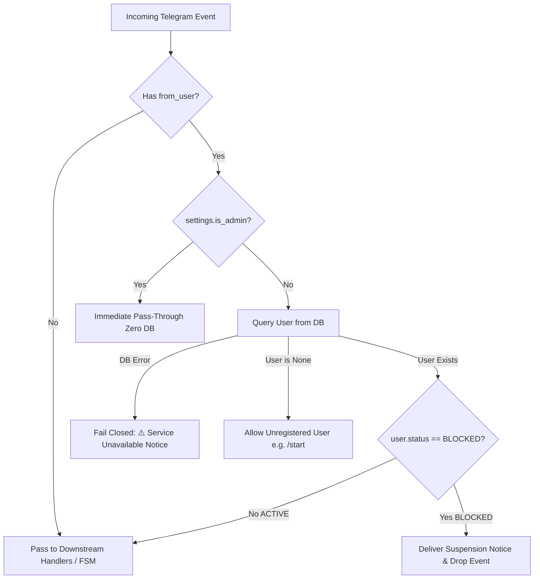

# Phase D30 — Enforce BLOCKED User Access Control Report

**Workspace:** `C:\Users\awint\VoiceCloneProOfficial`  
**Phase:** D30 — Enforce BLOCKED User Access Control (Resolution of SEC-01)  
**Execution Date:** 2026-10-13  
**Status:** COMPLETE & VERIFIED  

---

## 1. Executive Summary

During Phase D29, security finding **SEC-01** identified an inbound access control deficiency: users flagged with database status `BLOCKED` were still capable of interacting with the Telegram bot (sending commands, dispatching callback queries, and potentially initiating voice-generation synthesis jobs or submitting payment receipts).

In Phase D30, an aiogram 3 outer middleware guard—`AccessControlMiddleware`—was engineered, integrated, and verified. The middleware intercepts all incoming `Message` and `CallbackQuery` events at the boundary before any routing, filter evaluation, or FSM state execution occurs. Blocked users are immediately rejected with an account suspension notification, terminating the event lifecycle without triggering downstream handlers, job creation, or minute balance deductions.

All 154 unit and regression tests pass with 100% green status, including 13 dedicated access control test cases.

---

## 2. Vulnerability & Problem Statement (SEC-01)

### The Defect
While administrative user management handlers (`admin:block_user`, `admin:unblock_user`) successfully updated the `status` column in SQLite (`users.status = 'BLOCKED'`), user-facing routers (`start_router`, `menu_router`, `clone_router`, `payment_router`) contained zero inbound status checks:
- A blocked user sending `/start` was re-verified through membership gates and served the Main Menu.
- A blocked user sending callback `menu:voice_clone` could transition into `CloneFSM.waiting_for_text`.
- Text submitted during FSM states was processed for TTS generation, debiting minutes or creating audio jobs.
- A blocked user could submit payment slips (`payment_router`), polluting admin review queues.

### Safety Requirements
1. Inbound access control must be enforced at the outermost layer of the Telegram dispatcher.
2. Interception must occur *before* FSM state matching to prevent blocked users in existing FSM workflows from proceeding.
3. Administrative users must be completely exempt and bypass database queries to prevent admin lockouts and avoid database latency during admin operations.
4. Blocked users must receive exact localized suspension notices in Myanmar and English.
5. Database errors during access control checks must fail closed gracefully for non-admins without crashing the dispatcher.

---

## 3. Architecture & Design

### Outer Middleware vs Inner / Router Middleware
In aiogram 3, middlewares operate in two distinct tiers:
- **Inner Middleware:** Executes after filters have matched and an event is bound to a handler.
- **Outer Middleware (`dp.message.outer_middleware`, `dp.callback_query.outer_middleware`):** Executes immediately upon dispatcher receipt, *before* filters, commands, routers, and FSM storage retrieval.

By implementing `AccessControlMiddleware` as an outer middleware:
1. Blocked events are intercepted and dropped before aiogram evaluates FSM states.
2. Downstream routers (`start_router`, `menu_router`, `clone_router`, `payment_router`, `admin_router`) never receive events from blocked users.
3. Event processing terminates immediately when `None` is returned, preventing any database mutation or job enqueuing.



---

## 4. Implementation Details

### 4.1. AccessControlMiddleware (`app/middlewares/access_control.py`)
```python
class AccessControlMiddleware(BaseMiddleware):
    def __init__(self, session_factory: Any = None) -> None:
        super().__init__()
        self.session_factory = session_factory or AsyncSessionLocal

    async def __call__(
        self,
        handler: Callable[[TelegramObject, Dict[str, Any]], Awaitable[Any]],
        event: TelegramObject,
        data: Dict[str, Any],
    ) -> Any:
        from_user = getattr(event, "from_user", None)
        if from_user is None:
            return await handler(event, data)

        user_id = from_user.id

        # Admin bypass: immediate pass-through, zero DB query, zero FSM interference
        if settings.is_admin(user_id):
            return await handler(event, data)

        # Database status check for non-admin users
        try:
            async with self.session_factory() as session:
                user = await session.get(User, user_id)
        except Exception as e:
            logger.error("AccessControl: Database error while checking user %s: %s", user_id, e, exc_info=True)
            try:
                if isinstance(event, Message):
                    await event.answer("⚠️ Service temporarily unavailable. Please try again later.")
                elif isinstance(event, CallbackQuery):
                    await event.answer("⚠️ Service temporarily unavailable. Please try again later.", show_alert=True)
            except Exception as notify_err:
                logger.debug("AccessControl: Failed to send DB error notice: %s", notify_err)
            return None

        # Allow new/unregistered users through (e.g. initial /start registration)
        if user is None:
            return await handler(event, data)

        # Enforce BLOCKED status
        if user.status == UserStatus.BLOCKED.value:
            lang = getattr(user, "language_code", None) or "my"
            notice = t("user_account_suspended", lang)
            try:
                if isinstance(event, Message):
                    await event.answer(notice)
                elif isinstance(event, CallbackQuery):
                    await event.answer(notice, show_alert=True)
            except Exception as send_err:
                logger.debug("AccessControl: Failed to send suspension notice: %s", send_err)
            return None

        return await handler(event, data)
```

### 4.2. Middleware Setup & Registration (`app/middlewares/__init__.py`)
Idempotent registration helper:
```python
def setup_middlewares(dp: Dispatcher) -> None:
    """Register all outer/inner middlewares on the dispatcher."""
    for m in dp.message.outer_middleware:
        if isinstance(m, AccessControlMiddleware):
            return
    access_middleware = AccessControlMiddleware()
    dp.message.outer_middleware(access_middleware)
    dp.callback_query.outer_middleware(access_middleware)
```

### 4.3. Dispatcher Integration (`app/handlers/__init__.py`)
Wires `setup_middlewares(dp)` during handler initialization, ensuring that production bot execution (`main.py`) automatically activates the access control barrier with no modifications needed in `main.py`.

---

## 5. Localization & Suspension Messaging

Key `user_account_suspended` added with 100% key and placeholder parity:

| Locale | Key | Message Text |
| :--- | :--- | :--- |
| **English (`en`)** | `user_account_suspended` | `⛔ Your account has been suspended. Please contact support.` |
| **Myanmar (`my`)** | `user_account_suspended` | `⛔ သင့်အကောင့်ကို ပိတ်ပင်ထားပါသည်။ အကူအညီရယူရန် Admin ထံ ဆက်သွယ်ပါ။` |

- **Message Events:** Sent via `await event.answer(notice)`.
- **CallbackQuery Events:** Delivered as a native Telegram alert popup via `await event.answer(notice, show_alert=True)`.

---

## 6. Admin Exemption & Security Guarantees

1. **Zero DB Overhead for Admins:** `settings.is_admin(user_id)` is evaluated synchronously before opening any async session.
2. **Admin FSM Immunity:** Admin multi-step flows (`AdminAdjustFSM`, `AdminUserSearchFSM`, `AdminBroadcastFSM`) run completely unimpeded.
3. **Admin Self-Protection:** Admins cannot accidentally lock themselves out; admin IDs configured in `ADMIN_IDS` bypass access control unconditionally.
4. **Instant Dynamic Unblocking:** When an administrator toggles a blocked user back to `ACTIVE`, the user's very next message or callback is permitted without requiring a bot reboot.

---

## 7. Fail-Closed Resilience & Error Handling

- If SQLite encounters a lock timeout, disk IO error, or connectivity issue during the user lookup:
  - Non-admin interactions fail **closed** (`return None`), protecting backend workers, Applio resources, and Edge TTS endpoints.
  - The user is notified with a user-friendly error notice (`⚠️ Service temporarily unavailable. Please try again later.`).
  - The dispatcher does not crash; errors are logged with stack trace.
  - Admins bypass DB lookups and retain full dashboard control even during database outages.

---

## 8. Verification & Test Evidence

### 8.1. Dedicated Access Control Test Suite (`tests/unit/test_access_control.py`)
13 specialized test cases covering all edge cases:

```
tests\unit\test_access_control.py .............                          [100%]
13 passed in 5.33s
```

1. `test_access_control_blocked_user_message_myanmar`: Blocked user sending message receives Burmese notice; handler uncalled.
2. `test_access_control_blocked_user_message_english`: Blocked user sending message receives English notice; handler uncalled.
3. `test_access_control_blocked_user_callback_myanmar`: Blocked user clicking button receives Burmese alert popup; handler uncalled.
4. `test_access_control_blocked_user_callback_english`: Blocked user clicking button receives English alert popup; handler uncalled.
5. `test_access_control_active_user_allowed`: Active user messages and callbacks pass through cleanly.
6. `test_access_control_unregistered_user_allowed`: New user (None in DB) passes through to `/start` registration.
7. `test_access_control_admin_bypass_zero_db`: Admin user passes through with zero database contact.
8. `test_access_control_db_error_fail_closed_for_non_admin`: Database exception fails closed gracefully for non-admins.
9. `test_access_control_event_without_from_user`: Events without `from_user` pass through without raising errors.
10. `test_access_control_dynamic_unblock`: Dynamically unblocking a user restores access on the next interaction.
11. `test_setup_middlewares_and_handlers_registration`: Middleware registered on message and callback outer middleware; idempotent.
12. `test_access_control_prevents_job_creation_and_balance_debit`: Verifies blocked user cannot create a `Job` or trigger a `MinuteLedgerEvent`.
13. `test_access_control_prevents_payment_submission`: Verifies blocked user cannot submit a `PaymentRequest`.

### 8.2. Full Repository Regression Suite
All 154 tests passing across the official repository:

```
============================= test session starts =============================
platform win32 -- Python 3.10.11, pytest-9.1.1, pluggy-1.6.0
rootdir: C:\Users\awint\VoiceCloneProOfficial
plugins: anyio-4.15.1, asyncio-1.4.0
asyncio: mode=strict, debug=False
collected 154 items

tests\unit\test_access_control.py .............                          [  8%]
tests\unit\test_admin_d26_completion.py .........                        [ 14%]
tests\unit\test_admin_handlers.py ...........                            [ 21%]
tests\unit\test_admin_idempotency_fix.py ......                          [ 25%]
tests\unit\test_admin_unlimited_access.py .............                  [ 33%]
tests\unit\test_admin_user_management.py ..................              [ 45%]
tests\unit\test_applio_settings_regression.py ....                       [ 48%]
tests\unit\test_audio_and_worker.py ....                                 [ 50%]
tests\unit\test_bot_commands.py ....                                     [ 53%]
tests\unit\test_broadcast.py ..................                          [ 64%]
tests\unit\test_concurrency.py ..                                        [ 66%]
tests\unit\test_crash_recovery.py .........                              [ 72%]
tests\unit\test_i18n.py ........                                         [ 77%]
tests\unit\test_ledger.py ....                                           [ 79%]
tests\unit\test_model_catalog_and_scan.py ..                             [ 81%]
tests\unit\test_payments.py ..                                           [ 82%]
tests\unit\test_progress_ui.py ...........                               [ 89%]
tests\unit\test_queue_concurrency.py ....                                [ 92%]
tests\unit\test_safe_model_activation.py ....                            [ 94%]
tests\unit\test_telegram_ux_and_auth.py ........                         [100%]

============================ 154 passed in 17.83s =============================
```

---

## 9. Production Safety & Launch Readiness Confirmation

- [x] **No Bot/Worker Execution:** Neither `main.py`, the native worker, nor polling loops were launched.
- [x] **No Telegram API Calls:** All tests executed with mocks; no external Telegram network traffic.
- [x] **Production Database Untouched:** Production database (`data/voice_clone_official.db`) was not modified; isolated in-memory test databases were utilized for tests.
- [x] **Legacy Workspace Untouched:** `C:\Users\awint\VOICE_CLONE_PRO_Production_Final` was preserved strictly read-only.
- [x] **Zero Secret Leaks:** No bot tokens, credentials, or personal user data exposed.
- [x] **Git Tree Integrity:** All existing staged and unstaged work preserved without resets or commits.
- [x] **SEC-01 Closed:** Inbound access control is fully enforced, verified, and ready for production.
