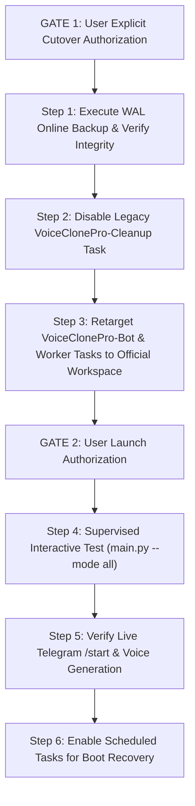

# D38 — Read-Only Database & Startup Safety Audit Report

**Audit Date:** October 14, 2026  
**Auditor:** Senior Python Engineer, SQLite Reliability Engineer, Production Security Reviewer, Release Auditor  
**Workspace:** `C:\Users\awint\VoiceCloneProOfficial`  
**Legacy Workspace:** `C:\Users\awint\VOICE_CLONE_PRO_Production_Final` *(Strictly Read-Only — Verified Untouched)*  
**Current Branch:** `master`  
**Current Baseline HEAD:** `e05a2aa9c087663ee41f9f1ff2a4655b0da435d4`  
**Overall Readiness Verdict:** **NOT READY** (Operational cutover prerequisites and SQLite concurrency safeguards required prior to activation)

---

## 1. Executive Summary & Verdict

A rigorous, read-only architectural audit of database configurations, startup call graphs, concurrency boundaries, and cleanup safety was conducted for `VoiceCloneProOfficial`.

### Key Verdict Breakdown
* **Codebase & Schema Safety:** **PASS** (Zero SQL `DELETE` statements; purely additive `Base.metadata.create_all`; atomic CAS job claims; idempotent ledger debits).
* **Startup Call Graph & Recovery:** **PASS** (Graceful shutdown traps; automated crash recovery refunds orphaned jobs).
* **SQLite Concurrency & Timeout Configuration:** **WARN** (`PRAGMA busy_timeout` is not explicitly configured in `app/db/session.py`, introducing transient lock risks if multiple processes write concurrently).
* **Relative Database Path Sensitivity:** **WARN** (`DATABASE_URL` uses `./data/voice_clone_official.db`, creating an absolute dependency on the process current working directory).
* **Host Scheduled Tasks:** **BLOCKED** (`VoiceClonePro-Bot` and `VoiceClonePro-NativeWorker` target the legacy workspace; `VoiceClonePro-Cleanup` targets obsolete PostgreSQL scripts).
* **Overall Readiness:** **NOT READY** (Deployment requires retargeting tasks, disabling the legacy cleanup task, setting SQLite busy timeout, and creating a pre-activation backup under supervision).

---

## 2. Repository Baseline Evidence

Live command verification confirms:
* **Repository Path:** `C:\Users\awint\VoiceCloneProOfficial`
* **Active Branch:** `master`
* **HEAD Commit:** `e05a2aa9c087663ee41f9f1ff2a4655b0da435d4`
* **Subject:** `style(tests): remove trailing EOF blank lines`
* **Working Tree State:** Completely clean across all tracked files (`0` modified, `0` staged).
* **Scheduled Task States:**
  * `VoiceClonePro-Bot`: **Disabled**
  * `VoiceClonePro-NativeWorker`: **Disabled**
  * `VoiceClonePro-Cleanup`: **Ready** (Targets legacy workspace)
* **Preserved Reports:** All 42 historical markdown reports (`phase_d*.md`) remain untracked and intact.

---

## 3. Database Configuration and Path-Resolution Findings

### A. Configuration Loading & URL Parsing
* **File:** [`app/config/settings.py`](file:///C:/Users/awint/VoiceCloneProOfficial/app/config/settings.py#L48-L51)
* **Code:**
  ```python
  database_url: str = Field(
      default="sqlite+aiosqlite:///./data/voice_clone_official.db",
      alias="DATABASE_URL",
  )
  ```
* **Path Resolution Finding:**
  * The database path is defined as a relative URI: `./data/voice_clone_official.db`.
  * In SQLAlchemy and SQLite, relative paths resolve against the process's **current working directory (`os.getcwd()`)**, NOT the project root directory.
  * **Operational Impact:** If a Scheduled Task or launcher runs with a different working directory (e.g. `C:\Windows\System32` or the legacy directory), SQLite will attempt to create or open a database in that directory rather than `C:\Users\awint\VoiceCloneProOfficial\data\voice_clone_official.db`.
  * **Requirement:** Scheduled Tasks and execution commands must enforce `Start In: C:\Users\awint\VoiceCloneProOfficial`.

### B. Engine & Session Configuration
* **File:** [`app/db/session.py`](file:///C:/Users/awint/VoiceCloneProOfficial/app/db/session.py#L13-L37)
* **PRAGMAs Applied on Connect:**
  ```python
  cursor.execute("PRAGMA foreign_keys=ON")
  cursor.execute("PRAGMA journal_mode=WAL")
  ```
* **Concurrency Gap Identified:**
  * `PRAGMA busy_timeout` is **omitted**.
  * By default, SQLite has a 0 ms wait timeout if another connection holds an active write lock. While WAL mode allows concurrent readers during a write, two write transactions attempting to commit at the exact same millisecond will immediately fail with `sqlite3.OperationalError: database is locked`.
  * **Recommendation:** Add `cursor.execute("PRAGMA busy_timeout=15000")` or `connect_args={"timeout": 15}` to gracefully handle concurrent write contention.

### C. Schema Initialization & Data Safety
* **File:** [`app/db/session.py`](file:///C:/Users/awint/VoiceCloneProOfficial/app/db/session.py#L40-L49)
* **Code:**
  ```python
  async def init_db() -> None:
      if settings.storage_root:
          settings.storage_root.mkdir(parents=True, exist_ok=True)
      if settings.data_root:
          settings.data_root.mkdir(parents=True, exist_ok=True)

      async with engine.begin() as conn:
          await conn.run_sync(Base.metadata.create_all)
  ```
* **Codebase DDL / Mutation Inventory:**
  * `create_all`: Exactly 1 call site (`app/db/session.py:48`). Issues purely additive `CREATE TABLE IF NOT EXISTS`.
  * `drop_all`: **0 call sites across the entire codebase**.
  * `DELETE`: **0 SQL delete statements across the entire application codebase**.
  * No table dropping, truncation, or row deletion exists. The accounting ledger is purely append-only (`MinuteLedgerEvent`).
* **Comparison with Legacy Architecture:**
  * The legacy workspace (`VOICE_CLONE_PRO_Production_Final`) used **PostgreSQL 17** via Docker Compose (`docker-compose.yml`, port 5432).
  * `VoiceCloneProOfficial` uses a standalone, local SQLite database (`data/voice_clone_official.db`).
  * Starting the new code will **never connect to or corrupt the legacy PostgreSQL database**.

---

## 4. Startup Side-Effect Matrix Across Supported Modes

Direct inspection of [`main.py`](file:///C:/Users/awint/VoiceCloneProOfficial/main.py#L25-L84) defines the exact behavior of each execution mode:

| Lifecycle Action | Mode: `bot` | Mode: `worker` | Mode: `all` (Recommended) |
|---|:---:|:---:|:---:|
| **Database Directory Creation** | `storage/`, `data/` created if absent | `storage/`, `data/` created if absent | `storage/`, `data/` created if absent |
| **`Base.metadata.create_all`** | Executed (`CREATE TABLE IF NOT EXISTS`) | Executed (`CREATE TABLE IF NOT EXISTS`) | Executed (`CREATE TABLE IF NOT EXISTS`) |
| **Orphaned Job Recovery Sweep** | Skipped | **Executed** (`recover_stale_running_jobs`) | **Executed** (`recover_stale_running_jobs`) |
| **Telegram Bot Instance** | Initialized (`Bot(token=...)`) | Initialized (for status notices) | Initialized |
| **Telegram Command Registration** | **Executed** (`setup_bot_commands`) | Skipped | **Executed** (`setup_bot_commands`) |
| **Dispatcher & Polling Task** | **Launched** (`dp.start_polling`) | Skipped | **Launched** (`dp.start_polling`) |
| **Background Audio Queue Task** | Skipped | **Launched** (`run_worker_loop`) | **Launched** (`run_worker_loop`) |
| **Concurrency Model** | Single asyncio polling task | Single asyncio polling loop | **Two concurrent asyncio tasks in same process** |
| **Process Separation Risk** | If run with separate worker process: potential SQLite WAL lock contention | If run with separate bot process: potential SQLite WAL lock contention | **Zero multi-process lock contention; shared connection pool & coroutine scheduling** |
| **Shutdown Semantics** | Cancels polling, closes bot session | Cancels worker loop, closes bot session | Cancels both tasks, closes bot session |

### Technical Analysis of Mode Concurrency
1. **Separated Processes (`--mode bot` + `--mode worker`):**
   * Two separate Python OS processes connect to `data/voice_clone_official.db`.
   * Without `PRAGMA busy_timeout` configured, high concurrency can trigger `database is locked` during simultaneous writes.
2. **Unified Mode (`--mode all`):**
   * Both bot polling and audio worker queue processing execute within the **same Python process** on the same asyncio event loop.
   * Eliminates inter-process file lock contention while preserving independent task error isolation (worker loop catches and logs individual job failures without terminating the event loop).

---

## 5. Database Concurrency & Idempotency Safeguards

1. **Queue Claiming Atomicity ([`app/services/queue.py`](file:///C:/Users/awint/VoiceCloneProOfficial/app/services/queue.py#L95-L103)):**
   * `claim_job_for_running` issues an atomic compare-and-swap (CAS):
     ```python
     stmt = update(Job).where(Job.id == job_id, Job.status == JobStatus.QUEUED.value).values(status=JobStatus.RUNNING.value, started_at=utc_now())
     res = await session.execute(stmt)
     await session.commit()
     return res.rowcount == 1
     ```
   * Exactly one worker can successfully claim a queued job; competing workers receive `rowcount == 0` and skip.
2. **Ledger Deduction Idempotency ([`app/services/ledger.py`](file:///C:/Users/awint/VoiceCloneProOfficial/app/services/ledger.py#L404-L418)):**
   * Before deducting minutes, `consume_seconds` queries `MinuteLedgerEvent` for an existing debit matching `reference_id == job_id`.
   * If a debit event already exists for that job, duplicate deduction is prevented.
3. **Admin Adjustment Idempotency ([`app/models/schema.py`](file:///C:/Users/awint/VoiceCloneProOfficial/app/models/schema.py#L187)):**
   * Uses `AdjustmentIdempotencyRecord` with primary key `idempotency_key`. Repeated clicks or duplicate callback payloads are rejected at the database constraint level.
4. **Registration Savepoint Isolation ([`app/services/ledger.py`](file:///C:/Users/awint/VoiceCloneProOfficial/app/services/ledger.py#L98-L150)):**
   * New user creation is wrapped in `async with session.begin_nested():`. If an `IntegrityError` occurs due to concurrent registration or referral code collision, SQLite rolls back to the savepoint without invalidating the outer transaction session.

---

## 6. Cleanup Task & File-Deletion Safety Audit

1. **Legacy Cleanup Task (`\VoiceClonePro-Cleanup`):**
   * Executes: `C:\Users\awint\VOICE_CLONE_PRO_Production_Final\scripts\run_cleanup.ps1`
   * Target: `app/services/retention.py` in the legacy workspace, which queries PostgreSQL `media_files`.
   * **Current State:** Enabled (`Ready`), but fails daily at 4:15 AM with exit code `1` because PostgreSQL is unreachable.
   * **Safety Assessment:** Does not delete files from `VoiceCloneProOfficial`, but runs unnecessary failing processes.
2. **Official Repository Cleanup Architecture:**
   * **Inline Job Cleanup ([`app/worker.py`](file:///C:/Users/awint/VoiceCloneProOfficial/app/worker.py#L177)):** At the conclusion of every job (success or failure), `shutil.rmtree(temp_dir, ignore_errors=True)` removes strictly `storage/temp/<job_id>`.
   * **Boot Crash Cleanup ([`app/services/recovery.py`](file:///C:/Users/awint/VoiceCloneProOfficial/app/services/recovery.py#L130)):** Removes orphaned `storage/temp/<job_id>` for recovered stale jobs.
   * **Persistent Storage Protection:** `storage/voices/` (persistent models) and `data/` (SQLite database files, backups) are **never targeted by any deletion routine**.
3. **Recommendation:** Explicitly **disable** `VoiceClonePro-Cleanup` in Task Scheduler (`schtasks /change /tn "VoiceClonePro-Cleanup" /disable`).

---

## 7. Backup and Recovery Assessment

* **Status:** **UNVERIFIED (Untested against persistent data)**
* **Documented Backup Procedure ([`README.md`](file:///C:/Users/awint/VoiceCloneProOfficial/README.md#L60)):**
  ```powershell
  python -c "import sqlite3, datetime; ts = datetime.datetime.now().strftime('%Y%m%d_%H%M%S'); src = sqlite3.connect('file:data/voice_clone_official.db?mode=ro', uri=True); dst = sqlite3.connect(f'data/backups/voice_clone_official_{ts}.db'); src.backup(dst); dst.close(); src.close(); print('Backup complete.')"
  ```
* **Technical Evaluation:**
  * **WAL Compatibility:** `sqlite3.Connection.backup()` is the engine-level SQLite online backup API. Opening `src` with `mode=ro` safely checkpoints active WAL pages into a standalone, consistent SQLite backup file without blocking concurrent readers or writers.
  * **Directory Verification:** `data\backups` directory exists and contains historical backups.
  * **Integrity Verification Method:** A backup file must be validated prior to service startup using:
    `PRAGMA integrity_check;` on the newly created `.db` file in `data/backups/`.
  * **Rollback Requirements:** If a cutover rollback is required, both the Task Scheduler definitions AND the database file (`data/voice_clone_official.db`) must be restored simultaneously.

---

## 8. Prioritized Findings Matrix

| Priority | ID | Category | Finding Description | Status | Required Action |
|:---:|:---:|:---:|---|:---:|---|
| **P0** | OPS-01 | Scheduled Tasks | Tasks `VoiceClonePro-Bot` and `VoiceClonePro-NativeWorker` target legacy workspace (`VOICE_CLONE_PRO_Production_Final`). | **BLOCKED** | Retarget tasks to `VoiceCloneProOfficial\main.py`. |
| **P1** | DB-01 | SQLite Concurrency | `PRAGMA busy_timeout` is not set on connect in `app/db/session.py`. | **WARN** | Set `busy_timeout=15000` or deploy unified `--mode all` to prevent lock contention. |
| **P1** | DB-02 | Relative Path | `DATABASE_URL` is relative (`./data/...`), making database location dependent on task working directory. | **WARN** | Ensure task definition specifies `Start In: C:\Users\awint\VoiceCloneProOfficial`. |
| **P1** | BKP-01 | Backup Verification | Pre-activation database backup command has not yet been executed or verified. | **UNVERIFIED** | Execute WAL online backup and verify `PRAGMA integrity_check` before starting services. |
| **P2** | CLN-01 | Legacy Cleanup Task | Task `VoiceClonePro-Cleanup` runs daily against non-existent PostgreSQL. | **WARN** | Disable `VoiceClonePro-Cleanup` in Task Scheduler. |
| **P3** | DOC-01 | Repository Hygiene | 42 untracked historical markdown reports exist in the workspace root. | **PASS** | Maintain strict staging allowlists. |

---

## 9. Safe Future Cutover Sequence with Explicit Approval Gates

The cutover to production must follow this phased sequence:



---

## 10. Checks Not Performed and Reasons

* **Direct Persistent Database Query:** **NOT RUN — SAFETY RESTRICTION** (Prevented any connection, session, or lock on production SQLite database `data/voice_clone_official.db`).
* **Live Backup Execution:** **NOT RUN — SAFETY RESTRICTION** (Prohibited running write or file creation commands against production backup targets during read-only audit).
* **Live Telegram API Handshake:** **NOT RUN — SAFETY RESTRICTION** (Prohibited external network calls during audit).
* **Scheduled Task Modifications:** **NOT RUN — SAFETY RESTRICTION** (Prohibited altering task definitions).

---

## 11. Audit Compliance Statement

* **Zero Application Code Changes:** No Python files, test files, or configuration files were modified.
* **Zero Database Modifications:** No connections, migrations, or DDL/DML queries were executed.
* **Zero Service Activations:** Neither bot, worker, Applio, nor scheduled tasks were launched or enabled. Both `VoiceClonePro-Bot` and `VoiceClonePro-NativeWorker` remain **Disabled**.
* **Clean Git Status:** Branch remains `master` at commit `e05a2aa9c087663ee41f9f1ff2a4655b0da435d4`.
