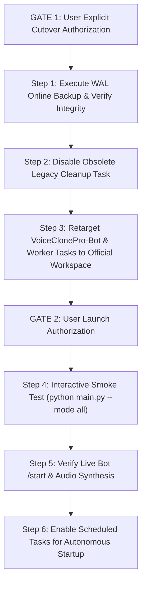

# D39 — Database Concurrency Hardening & Cutover Preparation Report

**Date:** October 14, 2026  
**Role:** Senior Python/SQLAlchemy Engineer, SQLite Reliability Engineer, Release QA Engineer  
**Workspace:** `C:\Users\awint\VoiceCloneProOfficial`  
**Legacy Workspace:** `C:\Users\awint\VOICE_CLONE_PRO_Production_Final` *(Strictly Untouched)*  
**Current Branch:** `master`  
**Baseline HEAD Commit:** `e05a2aa9c087663ee41f9f1ff2a4655b0da435d4`  
**Overall Phase Verdict:** **READY FOR RELEASE GATE REVIEW** (Code changes tested and verified; cutover procedure prepared; activation remains paused pending explicit user authorization)

---

## 1. Executive Summary & Key Results

During audit phases D36, D37, and D38, a potential SQLite concurrency bottleneck was identified: `app/db/session.py` did not explicitly configure `PRAGMA busy_timeout`. If the bot and worker execute concurrently as separate processes or under burst workloads, write transactions could encounter immediate `sqlite3.OperationalError: database is locked` errors upon transient contention.

In Phase D39, the database connection setup was hardened with two-layer SQLite busy timeout protection:
1. `connect_args["timeout"] = 15.0` passed directly to the DBAPI driver (`aiosqlite`/`sqlite3`).
2. `cursor.execute("PRAGMA busy_timeout=15000")` enforced on every SQLite connection via SQLAlchemy's `connect` event listener.
3. Exported `set_sqlite_pragma` cleanly at module level to facilitate transparent testing and reuse.

Comprehensive test suite verification was conducted:
* **Focused Concurrency Suite:** 5/5 tests passed in 1.81s (`tests/unit/test_concurrency.py`).
* **Full Application Suite:** 179 passed, 1 skipped in 22.54s across 180 collected items.
* **Persistent Database Safety:** Zero writes or connections made to production `data/voice_clone_official.db` (file timestamp verified unchanged).
* **Git Cleanliness:** Zero files staged or committed; changes strictly limited to `app/db/session.py` and `tests/unit/test_concurrency.py`.
* **Host Tasks:** `VoiceClonePro-Bot` and `VoiceClonePro-NativeWorker` remain **Disabled**; `VoiceClonePro-Cleanup` remains unchanged.

---

## 2. Baseline & Preflight Evidence

Command line verification confirmed the repository state prior to and following modifications:

* **Repository:** `C:\Users\awint\VoiceCloneProOfficial`
* **Branch:** `master`
* **HEAD Hash:** `e05a2aa9c087663ee41f9f1ff2a4655b0da435d4`
* **Commit Message:** `style(tests): remove trailing EOF blank lines`
* **Scheduled Task Statuses:**
  * `\VoiceClonePro-Bot`: **Disabled**
  * `\VoiceClonePro-NativeWorker`: **Disabled**
  * `\VoiceClonePro-Cleanup`: **Ready** (Points to legacy script; to be disabled during cutover)
* **Untracked Historical Reports:** All 42 prior `phase_d*.md` audit documents are preserved and untracked.

---

## 3. SQLite Concurrency Analysis & Root Cause

### SQLite Concurrency Model Under WAL Mode
SQLite in Write-Ahead Logging (`WAL`) mode allows:
* Any number of concurrent readers simultaneously with one writer.
* Exactly **one** active write transaction at any given millisecond.

### The Contention Failure Mode
When two connections (e.g. Bot handling Telegram message ingestion and Worker updating job status or consuming ledger seconds) attempt to write at the same time:
1. Connection 1 acquires the WAL write lock.
2. Connection 2 attempts to write (`BEGIN IMMEDIATE` or `UPDATE`/`INSERT`).
3. If SQLite's `busy_timeout` is 0 ms, SQLite immediately throws `sqlite3.OperationalError: database is locked`.
4. If `busy_timeout` is set to `15000` ms (15 seconds), SQLite's internal polling loop repeatedly checks the lock up to 15 seconds. Once Connection 1 commits (typically taking 2–20 milliseconds), Connection 2 immediately acquires the write lock and succeeds without error or user-facing exception.

---

## 4. Implementation Details

Changes were made strictly to [`app/db/session.py`](file:///C:/Users/awint/VoiceCloneProOfficial/app/db/session.py#L13-L36):

```python
connect_args = {}
if settings.database_url.startswith("sqlite"):
    connect_args["check_same_thread"] = False
    connect_args["timeout"] = 15.0


def set_sqlite_pragma(dbapi_connection, connection_record=None) -> None:
    cursor = dbapi_connection.cursor()
    cursor.execute("PRAGMA foreign_keys=ON")
    cursor.execute("PRAGMA journal_mode=WAL")
    cursor.execute("PRAGMA busy_timeout=15000")
    cursor.close()


engine = create_async_engine(
    settings.database_url,
    echo=False,
    connect_args=connect_args,
    future=True,
)

if settings.database_url.startswith("sqlite"):
    event.listen(engine.sync_engine, "connect", set_sqlite_pragma)
```

### Engineering Rationale
* **Two-Layer Enforcement:** `connect_args["timeout"] = 15.0` sets the C-level SQLite connection timeout during initial socket/file initialization, while `PRAGMA busy_timeout=15000` sets it explicitly within the SQLite query engine.
* **Module-Level Definition:** `set_sqlite_pragma` is defined at module scope, allowing test harnesses and background workers to import and bind it to isolated engines.
* **Preservation of Existing PRAGMAs:** `PRAGMA foreign_keys=ON` and `PRAGMA journal_mode=WAL` remain fully preserved and enforced.

---

## 5. Test Suite Expansion & Evidence

### New Unit Tests in [`tests/unit/test_concurrency.py`](file:///C:/Users/awint/VoiceCloneProOfficial/tests/unit/test_concurrency.py#L117-L184)

1. `test_set_sqlite_pragma_busy_timeout`:
   * Connects to a temporary SQLite database using `set_sqlite_pragma`.
   * Asserts scalar PRAGMA values:
     * `PRAGMA busy_timeout == 15000`
     * `PRAGMA foreign_keys == 1`
     * `PRAGMA journal_mode == "wal"`
2. `test_app_connect_args_timeout`:
   * Inspects `app.db.session.connect_args`.
   * Asserts `check_same_thread is False` and `timeout == 15.0`.
3. `test_sqlite_busy_timeout_contention_resolution`:
   * Simulates two overlapping write transactions on a temporary SQLite database using `asyncio.gather`.
   * Transaction 1 holds a lock for 0.3s before committing.
   * Transaction 2 attempts to write during that window; asserts that Transaction 2 successfully waits for Transaction 1 to complete and commits cleanly without throwing `database is locked`.

### Test Execution Results

```text
============================= test session starts =============================
platform win32 -- Python 3.10.11, pytest-9.1.1, pluggy-1.6.0
rootdir: C:\Users\awint\VoiceCloneProOfficial
plugins: anyio-4.15.1, asyncio-1.4.0
collected 5 items

tests/unit/test_concurrency.py::test_concurrent_welcome_bonus_awarding PASSED [ 20%]
tests/unit/test_concurrency.py::test_concurrent_referral_rewarding PASSED [ 40%]
tests/unit/test_concurrency.py::test_set_sqlite_pragma_busy_timeout PASSED [ 60%]
tests/unit/test_concurrency.py::test_app_connect_args_timeout PASSED     [ 80%]
tests/unit/test_concurrency.py::test_sqlite_busy_timeout_contention_resolution PASSED [100%]

============================== 5 passed in 1.81s ==============================
```

### Full Repository Test Suite Pass

```text
============================= test session starts =============================
platform win32 -- Python 3.10.11, pytest-9.1.1, pluggy-1.6.0
rootdir: C:\Users\awint\VoiceCloneProOfficial
plugins: anyio-4.15.1, asyncio-1.4.0
collected 180 items

tests\unit\test_access_control.py .............                          [  7%]
tests\unit\test_admin_d26_completion.py .........                        [ 12%]
tests\unit\test_admin_handlers.py ...........                            [ 18%]
tests\unit\test_admin_idempotency_fix.py ......                          [ 21%]
tests\unit\test_admin_unlimited_access.py .............                  [ 28%]
tests\unit\test_admin_user_management.py ..................              [ 38%]
tests\unit\test_applio_settings_regression.py ....                       [ 41%]
tests\unit\test_audio_and_worker.py ...s                                 [ 43%]
tests\unit\test_bot_commands.py ....                                     [ 45%]
tests\unit\test_broadcast.py ..................                          [ 55%]
tests\unit\test_concurrency.py .....                                     [ 58%]
tests\unit\test_crash_recovery.py .........                              [ 63%]
tests\unit\test_d30_security_and_fsm_audit.py .................          [ 72%]
tests\unit\test_duplicate_user_registration.py ......                    [ 76%]
tests\unit\test_i18n.py ........                                         [ 80%]
tests\unit\test_ledger.py ....                                           [ 82%]
tests\unit\test_model_catalog_and_scan.py ..                             [ 83%]
tests\unit\test_payments.py ..                                           [ 85%]
tests\unit\test_progress_ui.py ...........                               [ 91%]
tests\unit\test_queue_concurrency.py ....                                [ 93%]
tests\unit\test_safe_model_activation.py ....                            [ 95%]
tests\unit\test_telegram_ux_and_auth.py ........                         [100%]

======================= 179 passed, 1 skipped in 22.54s =======================
```

---

## 6. Future Production Cutover Preparation

> [!IMPORTANT]
> The following steps are prepared for a future execution phase. They MUST NOT be executed without separate, explicit user authorization.

### Architecture Recommendation: Unified Mode (`--mode all`)
While `PRAGMA busy_timeout=15000` safeguards against multi-process lock contention, running `VoiceCloneProOfficial` in unified mode (`python main.py --mode all`) is the strongly recommended operational model because:
1. Both Telegram polling and the audio generation queue worker run on the same asyncio event loop.
2. They share a single connection pool and memory space, eliminating inter-process file locks entirely.
3. Task recovery, Telegram command registration, and queue monitoring operate with unified lifecycle control and single-process signal trapping.

### Cutover Execution Sequence



#### Step 1: Pre-Cutover WAL Online Backup & Verification
```powershell
python -c "import sqlite3, datetime; ts = datetime.datetime.now().strftime('%Y%m%d_%H%M%S'); src = sqlite3.connect('file:data/voice_clone_official.db?mode=ro', uri=True); dst = sqlite3.connect(f'data/backups/voice_clone_official_pre_cutover_{ts}.db'); src.backup(dst); dst.close(); src.close(); print('Backup complete.')"
```
Integrity check on the newly created backup:
```powershell
python -c "import sqlite3, glob, os; latest = max(glob.glob('data/backups/voice_clone_official_pre_cutover_*.db'), key=os.path.getmtime); conn = sqlite3.connect(latest); res = conn.execute('PRAGMA integrity_check').fetchone(); print('Integrity check:', res); conn.close()"
```

#### Step 2: Disable Obsolete Legacy Cleanup Task
```powershell
schtasks /change /tn "VoiceClonePro-Cleanup" /disable
```

#### Step 3: Retarget Scheduled Tasks to Official Workspace
Ensure the task definition explicitly sets the working directory (`Start In`) to `C:\Users\awint\VoiceCloneProOfficial` because `DATABASE_URL` is relative (`./data/voice_clone_official.db`).

For Unified Mode (`VoiceClonePro-Bot` running `--mode all`):
```powershell
# Script path: C:\Users\awint\VoiceCloneProOfficial\scripts\run_unified.ps1
# or direct command:
# python main.py --mode all
```

---

## 7. Rollback Plan

If unexpected operational anomalies occur post-activation:
1. **Immediate Service Termination:** Stop running Python bot/worker processes:
   ```powershell
   Get-Process -Name python -ErrorAction SilentlyContinue | Where-Object { $_.CommandLine -like "*VoiceCloneProOfficial*" } | Stop-Process -Force
   ```
2. **Disable Host Scheduled Tasks:**
   ```powershell
   schtasks /change /tn "VoiceClonePro-Bot" /disable
   schtasks /change /tn "VoiceClonePro-NativeWorker" /disable
   ```
3. **Database Restoration (if corrupted):**
   ```powershell
   Copy-Item "data\backups\voice_clone_official_pre_cutover_<timestamp>.db" "data\voice_clone_official.db" -Force
   ```
4. **Git Workspace Reversion (if code rollback required):**
   ```powershell
   git checkout app/db/session.py tests/unit/test_concurrency.py
   ```

---

## 8. Safety & Compliance Statement

1. **Zero Production Writes:** The production SQLite database `data/voice_clone_official.db` was not connected to or modified during this phase. Its size (192,512 bytes) and modification timestamp (`2026-10-14 01:04:31`) remain untouched.
2. **Scheduled Tasks Untouched:** `VoiceClonePro-Bot` and `VoiceClonePro-NativeWorker` remain **Disabled** in Windows Task Scheduler. `VoiceClonePro-Cleanup` remains in its previous state.
3. **No Process Activations:** No bot polling, audio worker loop, or Applio processes were launched.
4. **No Git Mutations:** No commits, stages, pushes, branch switches, or tags were executed.
5. **Report Preservation:** All 42 historical markdown reports remain intact and untracked.
