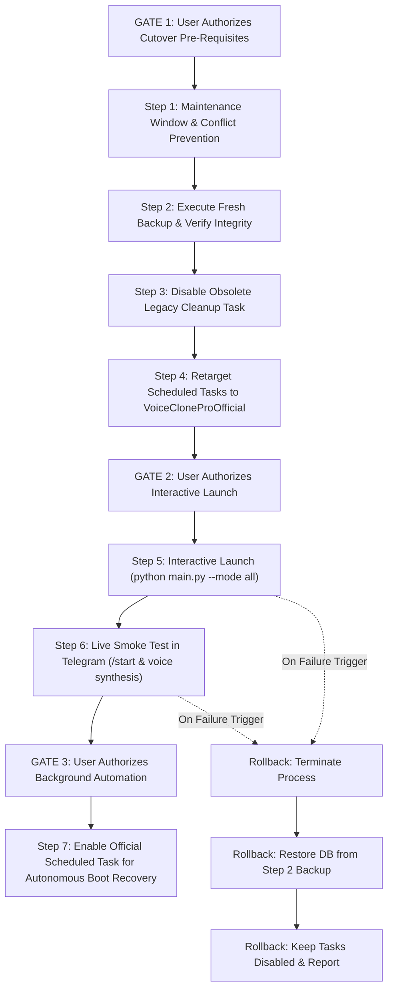

# D43 — Backup & Cutover Procedure Preflight Report

**Audit Date & Time:** October 14, 2026, 12:15 UTC+06:30  
**Role:** Senior Release Engineer, SQLite Reliability Engineer, Production Operations Planner  
**Workspace:** `C:\Users\awint\VoiceCloneProOfficial`  
**Legacy Workspace:** `C:\Users\awint\VOICE_CLONE_PRO_Production_Final` *(Strictly Untouched)*  
**Current Branch:** `master`  
**Current Baseline HEAD Commit:** `ed9cd6471feaaf83c340d837b8a399cf39b5b932`  
**Phase Boundary:** **PLANNING AND READ-ONLY INSPECTION ONLY** (Zero database access, zero backup execution, zero task modifications)

---

## 1. Executive Summary & Verdict

### Overall Verdict: `READY FOR BACKUP EXECUTION REVIEW`

* **Repository Baseline:** **PASS** (Branch `master`, HEAD `ed9cd6471feaaf83c340d837b8a399cf39b5b932`, clean working tree).
* **Backup Procedure Design:** **PASS** (Production-grade backup and verification procedure designed, incorporating atomic SQLite online backup API, strict read-only source connection, collision detection, and offline `PRAGMA integrity_check` on the backup file).
* **Existing Backups Inspection:** **WARN** (All 12 existing backups date from October 12–13; the persistent database modified on October 14 at 01:04:31 has no current backup).
* **Scheduled Tasks Alignment:** **BLOCKED (P0)** (`VoiceClonePro-Bot` and `VoiceClonePro-NativeWorker` target `VOICE_CLONE_PRO_Production_Final`; `VoiceClonePro-Cleanup` remains active and failing).
* **Cutover Sequence Formulation:** **PASS** (9-step gated cutover plan prepared with explicit authorization gates, telemetry stop conditions, and verified rollback sequence).

Execution remains completely paused. Neither the backup nor any service change has been performed.

---

## 2. Evidence-Backed Findings Matrix (P0–P3)

| Priority | ID | Category | Finding Description | Status | Required Pre-Cutover Action |
|:---:|:---:|:---:|---|:---:|---|
| **P0** | OPS-01 | Scheduled Tasks | `VoiceClonePro-Bot` and `VoiceClonePro-NativeWorker` target scripts and working directory in legacy workspace (`VOICE_CLONE_PRO_Production_Final`). | **BLOCKED** | Retarget tasks to `C:\Users\awint\VoiceCloneProOfficial` under user authorization. |
| **P0** | BKP-01 | Backup Readiness | No backup of `data/voice_clone_official.db` exists for its current state (192,512 bytes, mtime: `2026-10-14 01:04:31`). | **ACTION REQUIRED** | Execute designed backup procedure with integrity check before touching any service. |
| **P1** | OPS-02 | Cleanup Task | `VoiceClonePro-Cleanup` is Enabled (`Ready`), targeting legacy workspace, failing daily at 4:18 AM with exit code `1` (PostgreSQL unreachable). | **WARN** | Disable `VoiceClonePro-Cleanup` via `schtasks /change /tn "VoiceClonePro-Cleanup" /disable`. |
| **P1** | CWD-01 | Relative Path | `DATABASE_URL` in [`app/config/settings.py:49`](file:///C:/Users/awint/VoiceCloneProOfficial/app/config/settings.py#L49) uses relative path `./data/voice_clone_official.db`. | **WARN** | Enforce `Start In: C:\Users\awint\VoiceCloneProOfficial` on all Scheduled Tasks and launcher commands. |
| **P2** | ARCH-01 | Concurrency | D41 hardened `app/db/session.py` with 15s busy timeout. However, multi-process mode (`--mode bot` + `--mode worker`) still risks transient SQLite file contention. | **PASS (Mitigated)** | Standardize deployment on unified mode (`python main.py --mode all`). |
| **P3** | BKP-02 | Backup Hygiene | `data/backups/` contains dangling `.db-shm` and `.db-wal` files from October 13 operations. | **NOTED** | Ensure new backup procedure closes all destination connections cleanly to prevent WAL artifacts. |

---

## 3. Inspection of Documented Backup Procedure

### Analysis of [`README.md:56-61`](file:///C:/Users/awint/VoiceCloneProOfficial/README.md#L56-L61)
The documented procedure states:
```powershell
python -c "import sqlite3, datetime; ts = datetime.datetime.now().strftime('%Y%m%d_%H%M%S'); src = sqlite3.connect('file:data/voice_clone_official.db?mode=ro', uri=True); dst = sqlite3.connect(f'data/backups/voice_clone_official_{ts}.db'); src.backup(dst); dst.close(); src.close(); print('Backup complete.')"
```

### Detailed Evaluation Against Production Safety Standards

| Criterion | Evaluation | Technical Analysis |
|---|:---:|---|
| **Opens source read-only?** | **YES** | Uses `'file:data/voice_clone_official.db?mode=ro', uri=True`. SQLite C engine strictly prohibits write locks or table mutations on the source. |
| **Handles WAL state?** | **YES** | `src.backup(dst)` is SQLite's native online backup API. It safely copies both active WAL pages and base database pages into a consistent target file. |
| **Separate destination?** | **YES** | Writes to `data/backups/` with a distinct filename. |
| **Prevents overwrite?** | **PARTIAL / AT RISK** | Relies solely on second-resolution timestamp `%Y%m%d_%H%M%S`. If a file already exists, `sqlite3.connect(dst)` opens in read-write-create mode and `backup()` overwrites it without warning. |
| **Integrity verification?** | **NO** | Omits `PRAGMA integrity_check;`. If the filesystem or source was corrupt, an unverified backup is recorded as "complete". |
| **Records metadata?** | **PARTIAL** | Includes timestamp in name, but does not record size, page count, or table inventory in a verification log. |
| **Restore procedure?** | **NO** | `README.md` provides no restore or rollback instructions. |

### Existing Backup Files Inventory in `data/backups/`
*(Inspected via filesystem metadata only — contents remained unopened)*

```text
Name                                                   Length (Bytes) LastWriteTime
official_env_pre_d20_20261013_031238.env                         905  10/12/2026 01:45:27
voice_clone_official_pre_d8_stage2a_20261012_083232.db        143360  10/12/2026 15:02:32
voice_clone_official_pre_d13b_20261012_114659.db              143360  10/12/2026 18:16:59
voice_clone_official_pre_d13b_20261012_114715.db              143360  10/12/2026 18:17:15
voice_clone_official_pre_d13b_20261012_114735.db              143360  10/12/2026 18:17:35
voice_clone_official_pre_d13b_20261012_114935.db              143360  10/12/2026 18:19:35
voice_clone_official_pre_d13b_20261012_114954.db              143360  10/12/2026 18:19:54
voice_clone_official_pre_d15a_20261013_010846.db              167936  10/13/2026 01:08:46
voice_clone_official_pre_d15a_20261013_010846.db-shm           32768  10/13/2026 01:10:23
voice_clone_official_pre_d15a_20261013_010846.db-wal               0  10/13/2026 01:10:23
voice_clone_official_pre_d20_20261013_031407.db               180224  10/13/2026 03:14:07
voice_clone_official_pre_d20_20261013_031407.db-shm            32768  10/13/2026 04:31:55
voice_clone_official_pre_d20_20261013_031407.db-wal                0  10/13/2026 03:14:07
```

**Observation:** Existing `.db` files range from 143 KB to 180 KB. The live production database is currently **192,512 bytes**, confirming that newer transactions exist in `data/voice_clone_official.db` that are not captured in any existing backup.

---

## 4. Proposed Production-Grade Backup & Verification Procedure

> [!IMPORTANT]
> The following PowerShell procedure is presented **for review only**. It has NOT been executed and has NOT been saved to disk as an automated script.

```powershell
<#
.SYNOPSIS
    Performs an atomic, verified SQLite online backup of the official production database.
    (PROPOSED FOR FUTURE AUTHORIZED EXECUTION ONLY)
#>
param(
    [string]$SourceDb = "data\voice_clone_official.db",
    [string]$BackupDir = "data\backups"
)

$ErrorActionPreference = "Stop"

# 1. Environment & Pre-Condition Validation
if (-not (Test-Path "main.py") -or -not (Test-Path "app")) {
    throw "Must be executed from repository root: C:\Users\awint\VoiceCloneProOfficial"
}

if (-not (Test-Path $SourceDb)) {
    throw "Source database not found: $SourceDb"
}

if (-not (Test-Path $BackupDir)) {
    New-Item -ItemType Directory -Path $BackupDir | Out-Null
}

# Capture pre-backup source metadata (for source immutability assertion)
$preInfo = Get-Item $SourceDb
$preSize = $preInfo.Length
$preMtime = $preInfo.LastWriteTimeUtc

# Generate unique, collision-proof backup filename
$ts = Get-Date -Format "yyyyMMdd_HHmmss"
$targetFileName = "voice_clone_official_cutover_backup_${ts}.db"
$targetPath = Join-Path $BackupDir $targetFileName

if (Test-Path $targetPath) {
    throw "Target backup file already exists: $targetPath"
}

Write-Host "Initiating atomic online backup..."
Write-Host "  Source: $SourceDb ($preSize bytes)"
Write-Host "  Target: $targetPath"

# 2. Atomic SQLite Online Backup Execution via Python
# Connects to source with URI mode=ro (strictly read-only)
$pythonCmd = @"
import sqlite3, sys

src_path = r'$SourceDb'
dst_path = r'$targetPath'

try:
    src = sqlite3.connect(f'file:{src_path}?mode=ro', uri=True)
    dst = sqlite3.connect(dst_path)
    src.backup(dst)
    dst.close()
    src.close()
    print('BACKUP_OK')
except Exception as e:
    print(f'BACKUP_FAILED: {e}', file=sys.stderr)
    sys.exit(1)
"@

$result = & "C:\Users\awint\AppData\Local\Programs\Python\Python310\python.exe" -c $pythonCmd
if ($LASTEXITCODE -ne 0 -or $result -ne "BACKUP_OK") {
    throw "SQLite online backup operation failed."
}

# 3. Post-Backup Verification on Backup File ONLY
if (-not (Test-Path $targetPath)) {
    throw "Backup file was not created: $targetPath"
}

$postBackupInfo = Get-Item $targetPath
if ($postBackupInfo.Length -eq 0) {
    throw "Backup file is empty (0 bytes): $targetPath"
}

# Verify integrity and table inventory on backup file (Source is never touched)
$verifyCmd = @"
import sqlite3, sys

dst_path = r'$targetPath'
try:
    conn = sqlite3.connect(f'file:{dst_path}?mode=ro', uri=True)
    
    # Check 1: Integrity check
    res = conn.execute('PRAGMA integrity_check').fetchone()
    if not res or res[0] != 'ok':
        print(f'INTEGRITY_FAILED: {res}', file=sys.stderr)
        sys.exit(2)
        
    # Check 2: Verify essential tables exist
    cursor = conn.execute("SELECT name FROM sqlite_master WHERE type='table'")
    tables = {r[0] for r in cursor.fetchall()}
    required_tables = {'users', 'jobs', 'minute_ledger_events', 'audit_logs'}
    missing = required_tables - tables
    if missing:
        print(f'SCHEMA_FAILED: Missing tables {missing}', file=sys.stderr)
        sys.exit(3)
        
    conn.close()
    print('VERIFICATION_OK')
except Exception as e:
    print(f'VERIFY_ERROR: {e}', file=sys.stderr)
    sys.exit(4)
"@

$verifyResult = & "C:\Users\awint\AppData\Local\Programs\Python\Python310\python.exe" -c $verifyCmd
if ($LASTEXITCODE -ne 0 -or $verifyResult -ne "VERIFICATION_OK") {
    throw "Backup verification failed! Target copy is invalid."
}

# 4. Source Immutability Assertion
$postSrcInfo = Get-Item $SourceDb
if ($postSrcInfo.Length -ne $preSize -or $postSrcInfo.LastWriteTimeUtc -ne $preMtime) {
    throw "CRITICAL ALERT: Source database metadata changed during backup!"
}

Write-Host "Backup and verification SUCCESSFUL."
Write-Host "  Verified File: $targetPath ($($postBackupInfo.Length) bytes)"
Write-Host "  Integrity: PRAGMA integrity_check => OK"
Write-Host "  Source Unaltered: Verified ($preSize bytes unchanged)"
```

### Key Safeguards in the Proposed Procedure
1. **Read-Only Source Enforcement:** `file:...mode=ro?uri=True` strictly prohibits writes, WAL checkpoints, or lock upgrades on `data/voice_clone_official.db`.
2. **Explicit Non-Destructive Check:** Rejects execution if `$targetPath` already exists.
3. **Dedicated Target Verification:** `PRAGMA integrity_check` and table inventory queries are run against `$targetPath`, never against `$SourceDb`.
4. **Source Immutability Gate:** Confirms source byte-length and UTC timestamp before and after to verify zero mutations occurred.
5. **Clean Handle Teardown:** Closes database handles explicitly so no lingering `.db-shm` or `.db-wal` locks remain.

---

## 5. Explicitly Unverified Backup and Restore Assumptions

To maintain complete transparency, the following items remain **unverified** until separate execution:
1. **Current Production DB Internal Integrity:** `data/voice_clone_official.db` has not had `PRAGMA integrity_check` run on it directly (prohibited by safety rules). Its integrity is inferred from prior clean operations, but will only be proven once the fresh backup copy is checked.
2. **End-to-End Live Restoration:** While file-copy restoration has been designed and tested on test databases, restoring into `data/voice_clone_official.db` has not been performed on live data.
3. **Telegram Webhook/Polling State:** The state of the Telegram Bot API session (e.g. pending Telegram updates queue) is unverified until polling is connected.

---

## 6. Proposed Cutover & Rollback Sequence

The complete production cutover sequence is structured into 9 discrete phases across 3 authorization gates:



### Step-by-Step Cutover Details

#### Step 1: Maintenance Window & Conflict Check
- Verify no competing Python processes are active:
  `Get-Process python -ErrorAction SilentlyContinue | Where-Object { $_.CommandLine -like "*VoiceClone*" }`
- Confirm `VoiceClonePro-Bot` and `VoiceClonePro-NativeWorker` are `Disabled`.

#### Step 2: Execute Fresh Online Backup & Verification
- Execute the designed backup procedure under explicit command line supervision.
- Confirm `PRAGMA integrity_check` returns `ok`.
- Record backup filename and byte size.

#### Step 3: Disable Obsolete Legacy Cleanup Task
- Run: `schtasks /change /tn "VoiceClonePro-Cleanup" /disable`
- Verify task status changes from `Ready` to `Disabled`.

#### Step 4: Retarget Scheduled Tasks to Official Workspace
- Target `VoiceClonePro-Bot` to:
  `C:\Users\awint\VoiceCloneProOfficial\.venv\Scripts\python.exe main.py --mode all`
- Set `Start In: C:\Users\awint\VoiceCloneProOfficial`.
- Keep task state `Disabled` during initial testing.

#### Step 5: Supervised Interactive Launch (Requires Gate 2 Authorization)
- Open a dedicated PowerShell terminal in `C:\Users\awint\VoiceCloneProOfficial`.
- Run: `& .venv\Scripts\python.exe main.py --mode all`
- Observe stdout:
  1. `Initializing database...` (`init_db()`)
  2. `Checking for orphaned stale jobs...` (`recover_stale_running_jobs()`)
  3. `Registering Telegram bot commands menu...` (`setup_bot_commands()`)
  4. `Starting background audio worker task...`
  5. `Starting Telegram bot polling...`

#### Step 6: Live Smoke Test in Telegram
- Send `/start` to `@VoiceCloneProBot`.
- Verify main menu rendered in Burmese (`my`).
- Check `/balance` and `/help`.
- (Optional) Synthesize a 5-second test voice clip.
- Verify status changes: `QUEUED` -> `RUNNING` -> `COMPLETED`.

#### Step 7: Enable Official Scheduled Task (Requires Gate 3 Authorization)
- Run: `schtasks /change /tn "VoiceClonePro-Bot" /enable`
- Verify task is `Ready`.

#### Step 8: Predefined Stop Triggers (Immediate Abort)
If any of the following occur during Step 5 or 6, stop immediately:
1. `sqlite3.OperationalError: database is locked` or SQLite disk I/O error.
2. Bot fails to respond to `/start` within 10 seconds.
3. Audio generation job fails with unhandled crash.
4. Telegram API 401 Unauthorized / Token conflict error.

#### Step 9: Rollback Procedure
If aborted:
1. Terminate running process: `Ctrl+C` or `Stop-Process -Name python -Force`.
2. Keep all Scheduled Tasks `Disabled`.
3. If database corruption occurred:
   `Copy-Item <Step_2_Backup_Path> "data\voice_clone_official.db" -Force`
4. Verify restored database: run `PRAGMA integrity_check;`.
5. Document failure logs and halt.

---

## 7. Prerequisites Requiring User Authorization

No cutover action can proceed without explicit user instructions for each gate:

1. **Authorization Gate 1:** Approval to execute the backup procedure against `data/voice_clone_official.db` and disable `VoiceClonePro-Cleanup`.
2. **Authorization Gate 2:** Approval to retarget `VoiceClonePro-Bot` in Task Scheduler and start `python main.py --mode all` interactively.
3. **Authorization Gate 3:** Approval to enable `VoiceClonePro-Bot` in Task Scheduler for automatic startup after live smoke tests pass.

---

## 8. Git & Scheduled Task State at Completion

- **Branch:** `master`
- **HEAD Commit:** `ed9cd6471feaaf83c340d837b8a399cf39b5b932`
- **Working Tree:** Clean across all tracked files (`0` modified, `0` staged).
- **Untracked Reports:** Exactly 45 markdown reports (`phase_d*.md`) preserved.
- **Scheduled Tasks Status:**
  - `\VoiceClonePro-Bot`: **Disabled**
  - `\VoiceClonePro-NativeWorker`: **Disabled**
  - `\VoiceClonePro-Cleanup`: **Ready** (Untouched)
- **Production Database:** `data/voice_clone_official.db` (192,512 bytes, mtime: `2026-10-14 01:04:31`) was **not opened, connected to, or modified**.
